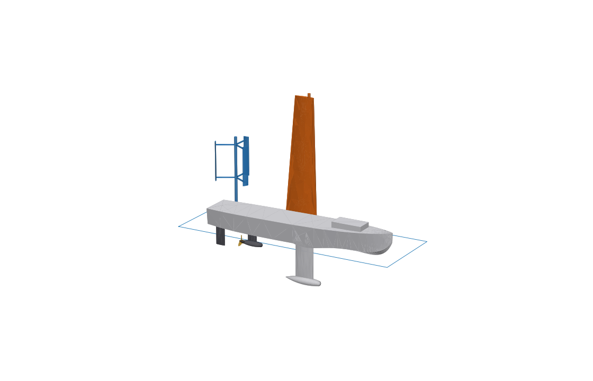
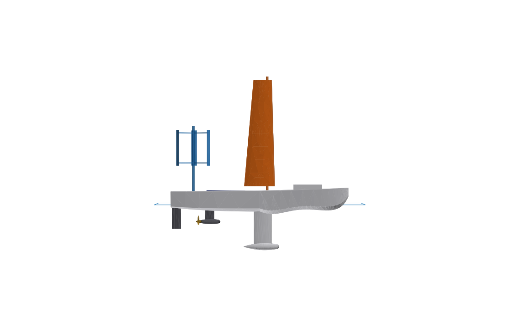

# 環球無人船 (Global Unmanned Ship) — 概念設計 v0.2 (3 m)

全長 3 m 的自主航行無人船，以**風力推進為主、風力/太陽能發電儲電、電力推進為輔**，目標為無補給長航程航行。




## 1. 動力與能源架構

```
            ┌─────────────── 風 ───────────────┐
            ▼                                   ▼
   剛性翼帆 WingSail (推進)            垂直軸風機 WindTurbine (發電)
            │                                   │ ~55 W @ 10 m/s
            │ 推力                               ▼
            │                    太陽能板 ──► MPPT / DC bus 24V ──► LiFePO4 電池組 ~1.5 kWh
            ▼                     ~55 Wp            ▲    │
         船體前進 ◄──────── 吊艙馬達 + 螺旋槳 ◄───────┘    └──► 航電 / 感測 / 衛星通訊
                          (~300 W，帆航時可反轉為水力發電機)
```

| 運轉模式 | 條件 | 推進 | 能源流向 |
|---|---|---|---|
| 純帆航 | 風速 ≥ 8 kn | 翼帆 | 風機 + 太陽能 → 充電 |
| 帆航 + 水力回充 | 航速夠快，電池未滿 | 翼帆 | 螺旋槳拖曳發電 + 風機 + 太陽能 → 充電 |
| 混合 | 弱風 / 逆風進港 | 翼帆 + 馬達 | 電池 → 馬達 |
| 純電 | 無風帶、港內、避碰 | 馬達 | 電池 → 馬達 |
| 風暴存活 | 風速 > 35 kn | 翼帆順風羽化 (自由旋轉) | 風機煞車停轉；只供航電 |

翼帆繞主桅自由旋轉 (轉軸在 1/4 弦長)，由桅底伺服馬達控制攻角，風暴時解鎖成風向標，以免過大側傾。龍骨壓載球提供復原力矩。

## 2. 主要尺寸 (模型量測)

| 項目 | 數值 |
|---|---|
| 全長 LOA | 3.0 m |
| 最大寬 | 0.55 m |
| 吃水 (含龍骨球) | 0.79 m |
| 甲板高 (水線以上) | 約 0.21–0.28 m |
| 設計水線排水量 (Z=0) | ≈ 126 kg (海水，由模型計算) |
| 水線面積 | ≈ 1.25 m² |
| 翼帆 | 展長 1.8 m，弦長 0.52 → 0.31 m，面積 ≈ 0.75 m² |
| 垂直軸風機 | H-Darrieus 3 葉，直徑 0.6 m × 高 0.6 m，掃掠面積 0.36 m² |
| 吊艙推進器 | 直徑 0.2 m 3 葉槳，吊艙長 0.4 m |
| 太陽能板 | 0.65 × 0.45 m (0.29 m²) |

尺寸以 12 m 版本 1:4 縮小為基礎，再針對小船調整：翼帆略矮、龍骨加深 (維持穩性)，風機相對放大 (維持發電量)。

能源數值 (風機 ~55 W、太陽能 ~55 Wp、電池 1.5 kWh、馬達 300 W) 都是概念階段的估算，需依實際選型與重量預算再驗證。3 m 船乾舷只有約 22 cm，海上會經常上浪，船體必須全水密並具備自行扶正能力。

## 3. 檔案

| 檔案 | 說明 |
|---|---|
| `GlobalUnmannedShip.FCStd` | FreeCAD 1.1 模型 (已上色) |
| `build_ship.py` | 模型產生器，重建整個 FCStd |
| `preview_*.png` | 預覽圖 |

重建：
```bash
# 無 GUI (不含顏色)
/Applications/FreeCAD.app/Contents/Resources/bin/freecadcmd build_ship.py
# 或在 FreeCAD 中: Macro ▸ Macros… ▸ 執行 build_ship.py (含顏色)
```
注意：重建會覆蓋 `GlobalUnmannedShip.FCStd`，在 GUI 裡手動做的修改會遺失。

## 4. 模型結構 (Part Design)

座標：**X** 船長方向 (0 = 船尾、+X 指向船艏)，**Y** 左舷，**Z** 向上 (Z=0 = 設計水線)，單位 mm。

```
GlobalUnmannedShip
├── Params                (試算表：全船佈置)
├── Hull                  Station0…7 → HullAft / HullFwd (Loft)
│                         KeelSketch → KeelFin (Pad)
│                         BulbSketch → BallastBulb (Revolution)
│                         DeckhouseSketch → Deckhouse (Pad)
│                         DeckDatum (甲板基準面，供新增草圖)
├── WingSail              MastSketch → Mast；WingRoot + WingTip → WingLoft
├── WindTurbine           TurbineMast、LowerArm、UpperArm、TurbineBlade → RotorPattern (×3)
├── ElectricPod           StrutSketch → Strut；PodSketch → MotorPod (Revolution)
├── Propeller             HubSketch → Hub；PropBladeSketch → PropBlade → PropPattern (×3)
├── Rudder                RudderSketch → RudderBlade
└── SolarArray            SolarSketch → SolarPanel
```

每個 Sketch 都**完全約束** (綠色)，主要尺寸都是**具名約束**。

## 5. 如何編輯

### 修改既有外形：雙擊 Sketch
在樹狀圖展開 Body，**雙擊 Sketch** 進入 Sketcher，雙擊尺寸修改，關閉後自動重算。

> ⚠️ 不要在 3D 視圖選取船殼或甲板後按「Create sketch」。船殼是曲面，甲板也有舷弧，都不是平面，會出現 **"Need a planar face as support for a sketch!"**。

| Sketch | 具名尺寸 |
|---|---|
| `Station0`…`Station7` (船體橫剖面) | `DeckHalfBeam`, `DeckHeight`, `ChineHalfBeam`, `ChineHeight`, `KeelHeight` |
| 所有翼型 (`WingRoot`, `WingTip`, `KeelSketch`, `RudderSketch`, `StrutSketch`, `TurbineBladeSketch`) | `Chord`, `HalfThickness`, `NoseRadius`, `Pivot` (前緣到轉軸) |
| 回轉體 (`BulbSketch`, `PodSketch`, `HubSketch`) | 同上 (半翼型繞軸旋轉，`HalfThickness` = 半徑) |
| `PropBladeSketch` | `RootRadius`, `TipRadius`, `RootWidth`, `EdgeRadius` |
| `MastSketch`, `TurbineMastSketch` | `Diameter` |
| `LowerArmSketch`, `UpperArmSketch` | `Width` (`Length` 綁定 `VAWT_R`) |
| `DeckhouseSketch`, `SolarSketch` | `Length`, `Width` (`Start` 綁定試算表) |

Station0 = 船尾，Station7 = 船艏；剖面位置 = `LOA × 比例`。船體分成兩段放樣，修改某一站只會影響鄰近區段。

### 新增特徵 (艙口、開孔、底座…)
1. 雙擊 `Hull` 設為作用中 Body
2. 在樹狀圖選 **`DeckDatum`** (甲板基準面，高度 = `Params.Deck_Z`)，或什麼都不選直接按 Create sketch，再從對話框選 `XY_Plane` / `XZ_Plane` / `YZ_Plane`
3. 畫草圖 → Pocket (向下開艙口) 或 Pad

### 佈置：改 `Params` 試算表
雙擊 `Params`，修改 B 欄數值：

- `LOA`：全長；船體站位和翼帆、龍骨、風機、吊艙、舵的 X 位置都依比例跟著移動 (寬度、高度仍要在 Station 草圖修改)
- `Wing_Angle` / `Rudder_Angle` / `Prop_Pitch`：翼帆轉角、舵角、槳距角 (deg)
- `Wing_Height`, `Keel_Depth`, `VAWT_R`, `VAWT_BladeH`, `Pod_Z`, `Deck_Z` …：高度、深度、半徑

綁定在試算表的尺寸在 Sketch 中會顯示為公式 (ƒx)，要改這些尺寸請改試算表。

## 6. 下一步

- 重量預算與重心 / 浮心配平；GZ 曲線 (復原力臂) 與自行扶正分析
- 翼帆換成 NACA 0015 B-spline 翼型，並加尾翼調整片 (trim tab)
- 船體加甲板拱度、內部艙壁、電池艙與水密艙劃分
- 翼帆與風機的遮蔽、干涉分析
- 匯出 STL / STEP 做 CFD (OpenFOAM) 阻力計算
