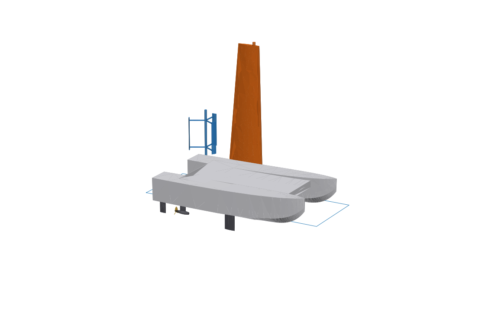
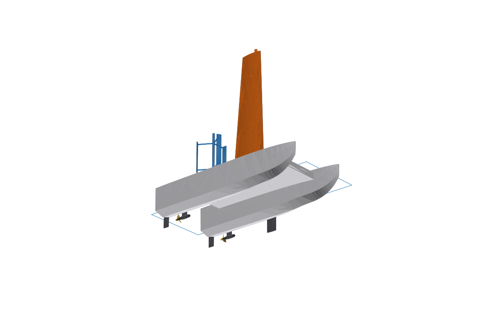
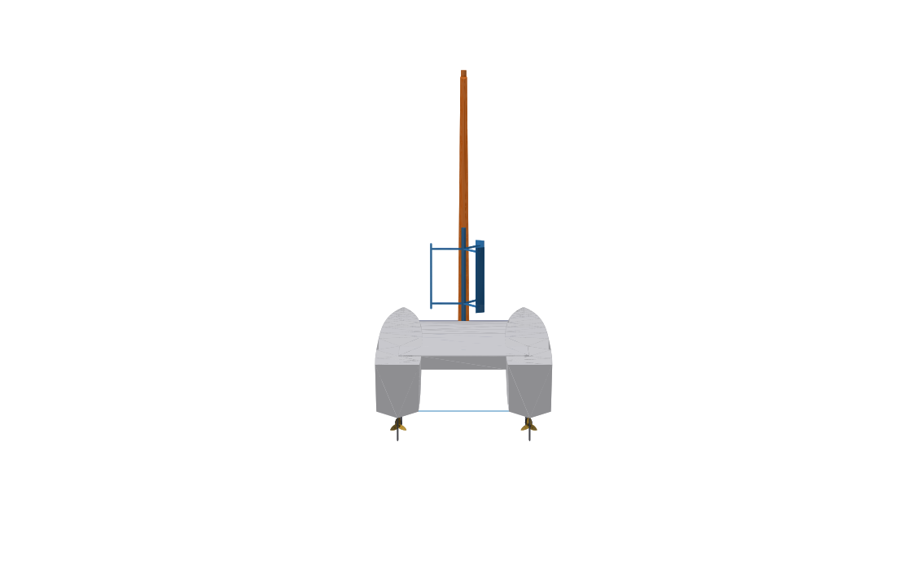

# 環球無人船 try-2 — 滑行式雙體船 (Planing Catamaran, 3 m)

在 try-1 的基礎上改成**深 V 滑行雙體船**：巡航靠風、衝刺靠電，電力衝刺模式可達 **25 節以上**。





## 1. 設計重點

| 項目 | try-1 單體帆船 | try-2 滑行雙體船 |
|---|---|---|
| 船型 | 硬舭單體 + 壓載龍骨 | 兩個深 V 滑行片體 + 橋甲板 |
| 穩性來源 | 鉛球龍骨 (重) | 片體間距 (寬 1.62 m)，不需壓載 |
| 最高速度 | 約 4 節 (排水型船體極限) | **約 27 節** (滑行，雙馬達 15 kW 全開) |
| 抗橫漂 | 固定龍骨 | 可收放穩向板 (滑行時收起) |
| 推進 | 單吊艙 | 雙吊艙、左右反轉槳 (抵銷扭矩，可差速轉向) |

**為什麼 25 節只能靠電力？** 滑行時阻力約為船重的 1/3（見下表）。翼帆在 20 節風中只有約 70–100 N 推力，不足以讓船進入滑行。所以帆航時是排水模式（約 3–6 節），25 節屬於電力衝刺模式。

## 2. 速度與功率 (估算)

Savitsky 滑行船法：每個片體分擔 72 kg，舭寬 0.38 m，底升角 17.5°，重心距船尾 0.95 m。附屬件濕面積取自模型 (0.305 m²)，空氣阻力已計入。

| 航速 | 縱傾 | 總阻力 | 有效功率 | 所需電力 (η=0.55) |
|---|---|---|---|---|
| 15 節 | 4.9° | 約 310 N | 2.4 kW | 4.3 kW |
| 20 節 | 3.8° | 約 400 N | 4.2 kW | 7.5 kW |
| **25 節** | 2.9° | 約 540 N | 6.9 kW | **12.6 kW** |
| 28 節 | 2.5° | 約 640 N | 9.2 kW | 16.8 kW |
| 30 節 | 2.3° | 約 710 N | 11.0 kW | 20.0 kW |

**建議動力配置**：雙馬達 2 × 7.5 kW (合計 15 kW，約 27 節)；NMC 電池 6 kWh (約 35 kg)。

- 25 節衝刺：約 28 分鐘，約 12 海里
- 太陽能 1.44 m² (約 280 Wp) 加風機，每天約發電 1.1–1.5 kWh，充滿電池需 4–5 天
- 25 節滑行只適合浪高 < 0.3 m 的平靜海況；3 m 船在大浪中無法維持高速

這些都是估算值，誤差可能到 ±30%，需以 CFD 或船模試驗驗證。

## 3. 主要尺寸 (模型量測)

| 項目 | 數值 |
|---|---|
| 全長 × 全寬 | 3.0 × 1.62 m |
| 片體間距 (中心線) | 1.2 m |
| 片體舭寬 | 0.38 m，底升角 17.5° (船尾) |
| 吃水 | 片體 0.12 m；穩向板放下 0.40 m |
| 設計水線排水量 | ≈ 145 kg (由模型計算) |
| 濕甲板離水高 | 0.26 m |
| 翼帆 | 展長 2.4 m，弦長 0.70 → 0.42 m，面積 ≈ 1.34 m² |
| 垂直軸風機 | 直徑 0.6 m × 高 0.6 m |
| 螺旋槳 | 2 × 直徑 0.17 m，螺距角 35° |
| 太陽能板 | 1.45 × 1.0 m (中央開孔讓主桅穿過) |

## 4. 模型結構 (`GlobalUnmannedCat.FCStd`)

只建右舷 (+Y) 一側，左舷由 **Mirrored** 自動產生：**改一邊、兩邊同步**。

```
GlobalUnmannedCat
├── Params                (試算表：全船佈置)
├── Hull                  Station0…7 (右舷片體) → HullAft / HullFwd (Loft)
│                         BridgeDeckSketch → BridgeDeck (Pad)
│                         MirrorHull (鏡像出左舷片體)
│                         DeckDatum (= 橋甲板頂面)
├── WingSail              MastSketch → Mast；WingRoot + WingTip → WingLoft
├── WindTurbine           TurbineMast、LowerArm、UpperArm、TurbineBlade → RotorPattern (×3)
├── Daggerboards          DaggerSketch → Daggerboard → MirrorDagger
├── ElectricPods          StrutSketch → Strut；PodSketch → MotorPod → MirrorPod
├── Propellers            HubSketch → Hub → MirrorHub；PropBladeSketch → PropBlade → PropPattern (×3 + 鏡像)
├── Rudders               RudderSketch → RudderStbd；RudderSketchPort → RudderPort
└── SolarArray            SolarSketch (矩形 + 主桅孔) → SolarPanel
```

## 5. 如何編輯

### 修改外形：雙擊 Sketch
| Sketch | 具名尺寸 |
|---|---|
| `Station0`…`Station7` (右舷片體橫剖面) | `DeckHalfBeam`, `DeckHeight`, `ChineHalfBeam`, `ChineHeight`, `KeelHeight` |
| 翼型 (`WingRoot`, `WingTip`, `DaggerSketch`, `RudderSketch`, `StrutSketch`, `TurbineBladeSketch`) | `Chord`, `HalfThickness`, `NoseRadius`, `Pivot` |
| 回轉體 (`PodSketch`, `HubSketch`) | 同上 (`HalfThickness` = 半徑) |
| `PropBladeSketch` | `RootRadius`, `TipRadius`, `RootWidth`, `EdgeRadius` |
| `SolarSketch` | `Width`, `HoleDiameter` |

- **底升角** = atan((ChineHeight − KeelHeight) / ChineHalfBeam)，改 `KeelHeight` 即可調整
- 兩舵需同向轉動，所以不用鏡像；`RudderSketchPort` 的尺寸跟隨 `RudderSketch`，只要改右舷
- 同一段 Loft 內的站距要保持相等 (後段 St0–St4 每 500 mm、前段 St4–St7 每 333 mm)，否則龍骨線會起伏

### 新增特徵
橋甲板頂面是平面，可以直接選它 (或選 `DeckDatum`) 建立草圖。片體甲板有舷弧，不是平面，選它會出現 "Need a planar face"。

### 佈置：`Params` 試算表
- `Hull_Y`：片體間距的一半 (橋甲板寬度自動跟著變)
- `Dagger_Up`：穩向板收起量 (高速滑行設 450)
- `Wing_Angle` / `Rudder_Angle` / `Prop_Pitch`：翼帆角、舵角、槳距角 (deg)
- `LOA`, `BD_Z` (濕甲板高), `Wing_Height`, `Pod_Z` …

## 6. 重建

```bash
/Applications/FreeCAD.app/Contents/Resources/bin/freecadcmd build_ship.py   # 無顏色
# 或 FreeCAD 中 Macro ▸ Macros… ▸ 執行 build_ship.py (含顏色)
```
重建會覆蓋 `GlobalUnmannedCat.FCStd`。

## 7. 下一步

- 片體加**滑行階梯 (step)** 與**噴濺條 (spray rail)**，可再降低 10–15% 阻力
- 加尾板 **trim tab**，讓 25 節時縱傾維持在最佳 4° 左右 (目前 2.9°，摩擦阻力偏高)
- 重量預算與重心配置 (目前假設 LCG 距船尾 0.95 m)
- 高速時翼帆鎖定順風並降低高度 (或可傾倒桅)，減少空氣阻力與翻覆風險
- 雙體船的橫搖、波浪中拍擊 (slamming) 與濕甲板間隙分析
